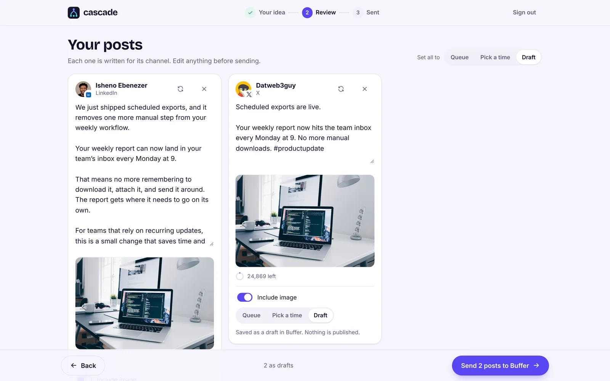
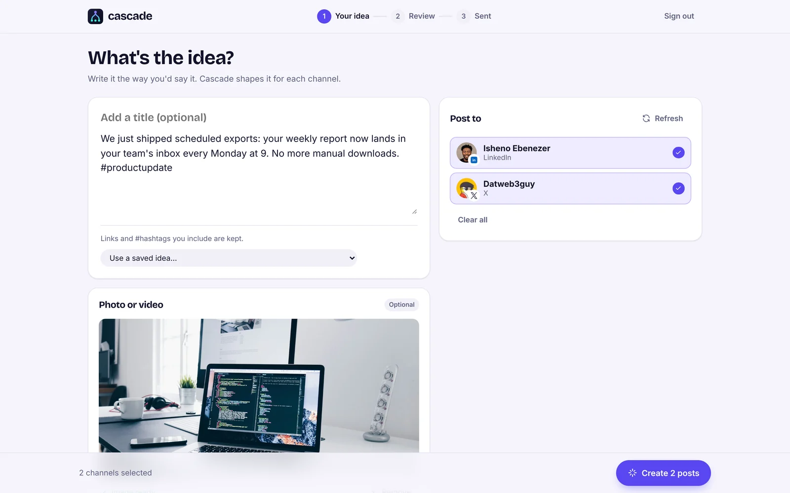
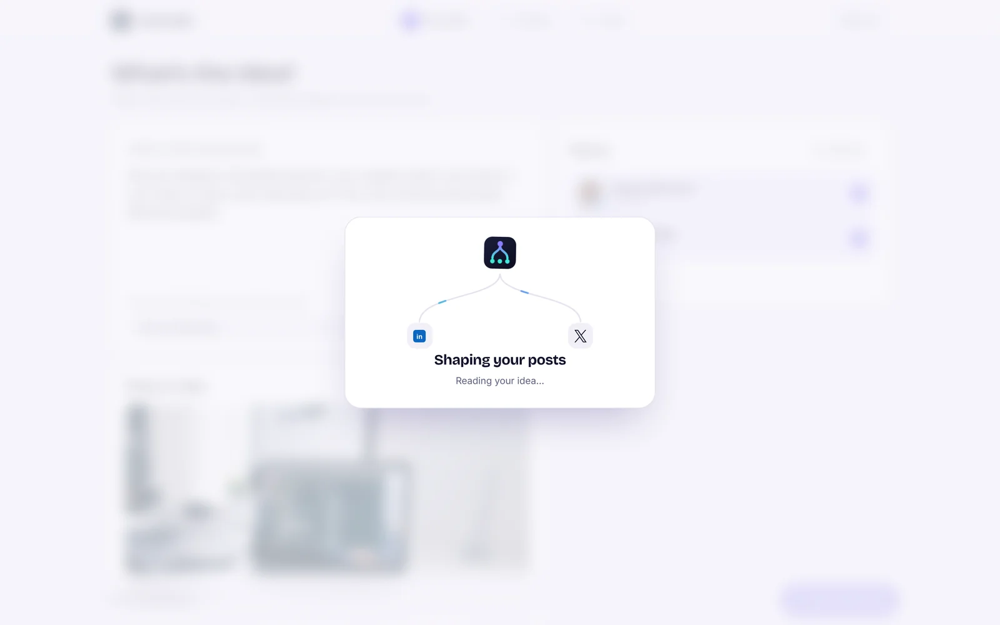
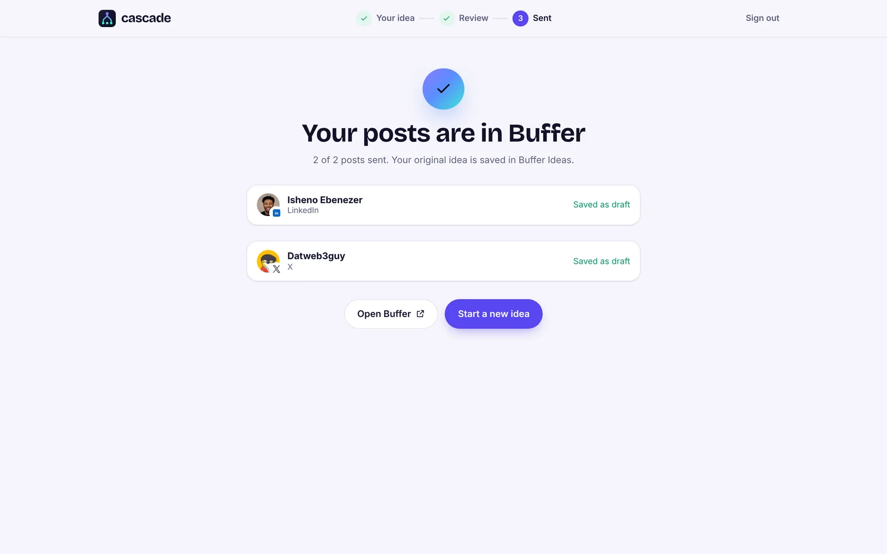
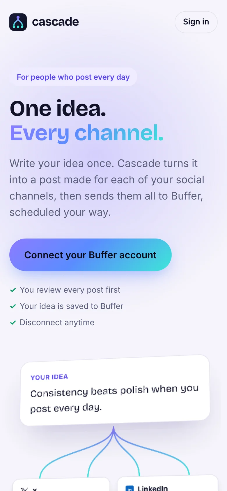

# Cascade

**Write one idea. Get a post made for every network. Ready in Buffer.**

Live: **https://oncascade.vercel.app** · ▶ **[Watch the demo (1:19)](https://youtu.be/8lEK_hZaYQM)** · Built on the Buffer API for Buffer Commit 2026



## Who it's for

People who post every day across several networks with Buffer:

- **Founders** announcing what they shipped on X, LinkedIn and Threads.
- **Small businesses** sharing today's offer on Instagram, Facebook and Google.
- **Creators** promoting a new video or newsletter everywhere they post.

## The problem

Buffer already solved the posting. The writing is still on you. X wants it short, LinkedIn wants the story, Instagram wants a caption. So most people either paste the same text everywhere, which reads badly, or rewrite it by hand for every network, every day.

Cascade does that step. You write the idea once, in your own words. Cascade writes a version for each network and puts them all in Buffer: queued, scheduled or as drafts.

## How it works

| 1. Write it once | 2. Get a post for each network | 3. Send to Buffer |
| --- | --- | --- |
|  |  |  |
| Sign in with Buffer. Your channels load from Buffer. Write the idea, add a photo or video (upload it or paste a link), pick channels. | Each network gets its own version, in its own style, checked against Buffer's character rules. Edit anything or ask for a fresh version. | Choose per channel: Buffer queue, a set time in that channel's time zone, or a draft. One tap sends them all and saves your idea in Buffer Ideas. |

## What happens after you send

Cascade doesn't publish on its own. **Buffer does**, using the choice you made for each post:

| You choose | What happens |
| --- | --- |
| **Queue** | Buffer publishes it automatically at the next open slot in that channel's posting schedule. |
| **Pick a time** | Buffer publishes it automatically at that time, in the channel's time zone. |
| **Draft** | Nothing is published. It waits in Buffer's Drafts until you schedule or publish it there. |

Queued and scheduled posts go out even if you close Cascade. Every post can still be edited, rescheduled or deleted in Buffer, and your original idea stays in Buffer Ideas to reuse.

<p align="center"></p>

<p align="center"></p>

## Your words, nothing added

- Cascade never adds hashtags or emojis you didn't write. Every draft is filtered on the server, not just prompted.
- Links you include are kept exactly.
- Nothing is published without your review. Drafts never publish.

## How it uses the Buffer API

| What | Buffer API |
| --- | --- |
| Sign in | OAuth 2.0 Authorization Code with PKCE, private App Client, refresh tokens |
| Your workspaces and channels | `account { organizations }`, `channels` (with Mastodon limit, X subscription, Pinterest boards from channel metadata) |
| Start from a saved idea | `ideas` (paginated) |
| Save the original idea | `createIdea` |
| One post per network | `createPost` with media assets, queue / custom time / draft, and network settings (Instagram and Facebook post type, Pinterest board, YouTube title and visibility) |
| Safe retries | `posts` lookup after a timeout, because `createPost` has no idempotency key |

Details that matter when acting on someone else's Buffer account:

- Tokens stay on the server in Redis; the browser only holds an encrypted session ID.
- Buffer rotates refresh tokens and revokes the grant if an old one is reused, so refreshes are serialised with a lock.
- Character counts follow Buffer's own rules: X weighting, LinkedIn and Mastodon link weights, Instagram line breaks, Bluesky graphemes.
- Media is hosted at a stable public URL (Vercel Blob), because Buffer fetches it when the post goes out. Instagram gets a cropped copy when a photo's shape won't auto-publish.
- `429` responses are honoured with `Retry-After`; the channel list is cached per session to protect the shared rate limit.
- Typed mutation errors are shown per channel in plain language; failed channels can be retried without duplicating the rest.

## Run it locally

Requirements: Node.js 22+, a Buffer App Client, an OpenAI API key.

```bash
cp .env.example .env.local   # fill in the values; comments explain each one
npm install
npm run dev                  # https://localhost:3000 (Buffer requires HTTPS redirect URIs)
```

Register `https://localhost:3000/api/auth/callback` (and your production URL) on the App Client. Production also needs a Redis store and a Blob store; both are one click in Vercel Storage.

Checks: `npm run typecheck` and `npm test`.

## Built during Buffer Commit

Everything here was built between October 28 and November 13, 2026.

## Next

First comments and threads, multi-image posts, saved voice and tone preferences, and a team review step before posts go to Buffer.

Not affiliated with Buffer. [Privacy](https://oncascade.vercel.app/privacy)
